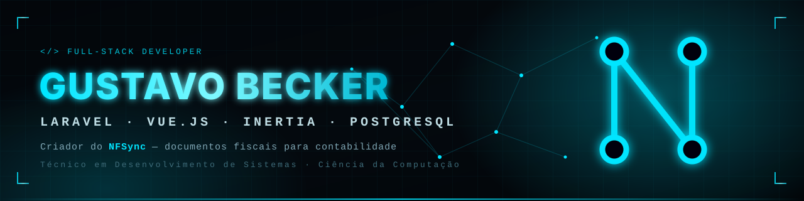
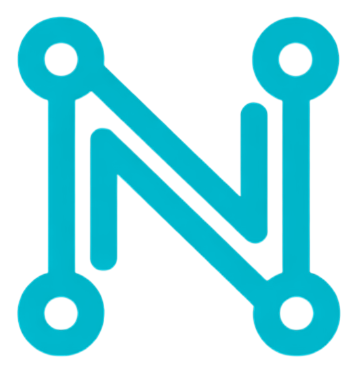
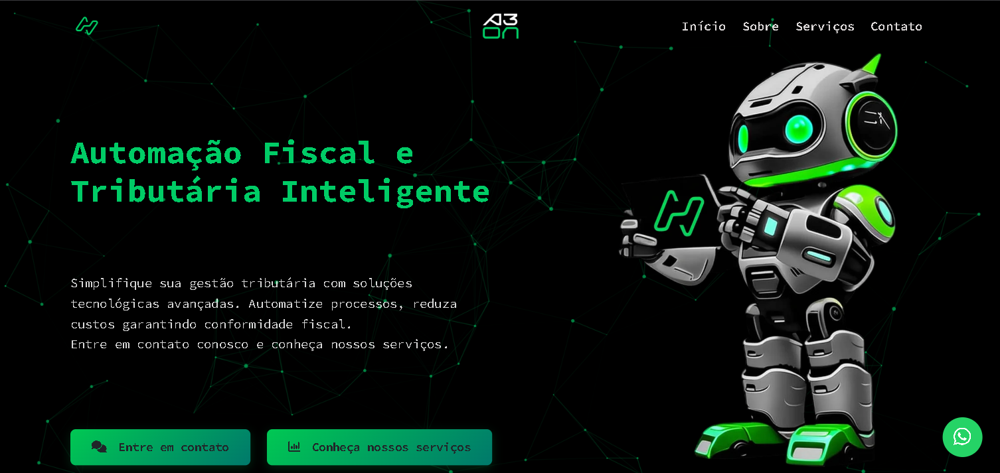

  

  

  
  
  

 

## [ SOBRE ]

Desenvolvedor **full-stack** focado em soluções robustas, escaláveis e de alta performance. Técnico em Desenvolvimento de Sistemas e graduando em Ciência da Computação.
Construo sistemas complexos que resolvem dores reais de negócio, unindo arquitetura sólida no back-end com interfaces modernas e reativas.

- ⚡ **Criador do NFSync**: plataforma especializada para escritórios de contabilidade acessarem e centralizarem documentos fiscais dos clientes
- 🛠️ **Ecossistema principal**: PHP 8+, Laravel, Vue.js, Inertia.js e PostgreSQL
- 🚀 **Escala & Performance**: Filas assíncronas de alto processamento com Redis e Laravel Horizon
- 🎨 **Visual & Usabilidade**: Estética dark, neon e design de interfaces funcionais e refinadas

 

## [ PROJETO EM DESTAQUE ]

  
  <h3>⚡ NFSync — Gestão Inteligente de Documentos Fiscais</h3>
  

    <b>Os documentos fiscais dos seus clientes, no lugar certo e em tempo real.</b> 
    Plataforma desenvolvida sob medida para escritórios de contabilidade capturarem, gerenciarem e centralizarem 
    os documentos fiscais (XMLs, NF-e, NFS-e, CT-e) emitidos por seus clientes, eliminando processos manuais.
  

  
    
  
  
  
  
  
  
    
  

 

## [ STACK & TECNOLOGIAS ]

  

 

  
  
  
  
  
  
  
  
  
  

 

## [ ESTATÍSTICAS ]

  
  

 

  

 

## [ ATIVIDADE ]

  

 

  

 

  
  Desenvolvido com Laravel, Vue.js, Inertia & Cyberpunk Neon Cyan.

